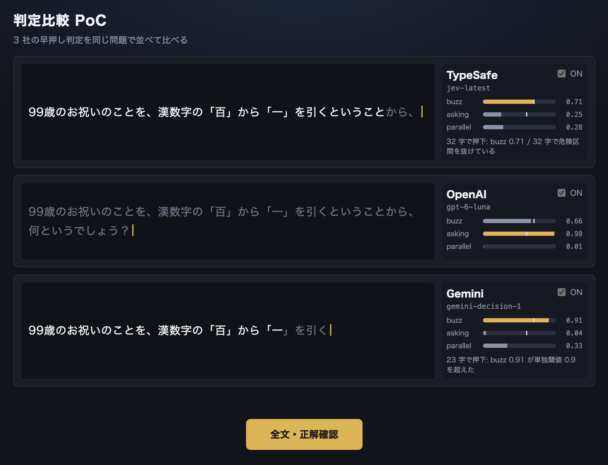

# jev-poc（判定比較 PoC）



同じ問題を TypeSafe（Jev）/ OpenAI Decisions / Gemini Decision 1 の 3 社に並列で投げ、**押しポイントと応答の遅れを並べて比べる** PoC。

人間の早押しや LLM による回答は持たない。Judge と LLM の組み合わせや人間との対決は[オンライン版](online.md#ai-参加者)で行う。

出題データは [quiz-data.md](quiz-data.md)。

## 起動

`server` が起動している必要がある。

```bash
cp server/.env.example server/.env
```

使う provider のキーを `server/.env` に設定する（`TYPESAFE_API_KEY` / `OPENAI_API_KEY` / `GEMINI_API_KEY`）。
キーが無い枠は OFF に固定される。

```bash
cd server && uv run uvicorn app.main:app --port 8000
```

別のターミナルで:

```bash
npm run dev -w jev-poc
```

`dev` / `build` は、実行前に `questions.csv` を読んで `quiz_data/manifest.jev-poc.json` を生成する。
凍結 `poc/` の `manifest.json` とは出力先が違う。

## 操作

1. 待機画面で各枠の ON/OFF を選ぶ（キーの無い枠はトグル不可）
2. 「出題する」でジングルのあと読み上げが始まる
3. 各枠が独立に判定し、押した枠は白（基準位置）と灰（応答到達位置）で押しポイントを示す
4. 読み切り後に「全文・正解確認」でモーダルを開き、正解を確認して「次へ」

効果音は出題時の `set` だけ。枠が押しても `buzz` は鳴らさない。

### 画面の見かた

| 色 | 意味 |
| --- | --- |
| 白 | 判定の基準位置（送信時点）までの文字 |
| 灰 | 応答が届いた時点までに読み進んだ文字。**その枠は見ていない** |

灰色の長さがそのまま**応答の遅れ**である。

右側のゲージは buzz / asking / parallel の直近値。押した枠は押下判定の値のまま止まる。

## 出題サイクル

```
待機 ──出題する──▶ jingle ──▶ reading ──読み切り──▶ readEnded ──全文・正解確認──▶ reveal
 ▲                                                                                │
 └──────────────────────────────────── 次へ ◀─────────────────────────────────────┘
```

- 待機中だけ枠の ON/OFF を変えられる
- 音声あり: 再生が終わるまで読み切りにしない（全枠が押しても再生は続ける）
- 音声なし: 全文を出し終えたとき、または ON の全枠が押したときに読み切り（文字送り 120ms 固定）

## 押下規則

閾値は [`server/app/judge/decision.py`](../server/app/judge/decision.py) と [`jev-poc/src/lib/decision.ts`](../jev-poc/src/lib/decision.ts) の**両方**にある。全 provider で共通。

計測は `server/scripts/measure_buzz_curve.py --provider openai` のように provider を選んで行う。

## 判定 API

オンライン版と同じ `/api/judge/*`。jev-poc は枠ごとに `provider` を付けて呼ぶ。

### `GET /api/judge/health`

```json
{
  "available": true,
  "provider": "typesafe",
  "model": "jev-latest",
  "narrowed_levels": 4,
  "reading_ended_delay_ms": 5000,
  "providers": [
    { "id": "typesafe", "label": "TypeSafe", "model": "jev-latest", "available": true },
    { "id": "openai", "label": "OpenAI", "model": "gpt-6-luna", "available": false, "reason": "…" },
    { "id": "gemini", "label": "Gemini", "model": "gemini-decision-1", "available": true }
  ]
}
```

枠の可否は `providers[]` だけで決める。トップレベルの `available`（既定 provider の可否）は見ない。

### `POST /api/judge/judge`

```json
{ "partial_text": "日本の小説家で", "provider": "openai" }
```

`provider` を省略すると `JUDGE_PROVIDER`（未設定なら typesafe）を使う。

## 環境変数（server）

| 変数 | 内容 |
| --- | --- |
| `JUDGE_PROVIDER` | 既定の provider。空なら `typesafe` |
| `JUDGE_MODEL` | 既定 provider だけに効くモデル上書き |
| `TYPESAFE_API_KEY` / `OPENAI_API_KEY` / `GEMINI_API_KEY` | 各社のキー |

## ディレクトリ

```
server/app/judge/
├── client.py           provider への振り分け
├── typesafe.py / openai_provider.py / gemini_provider.py
├── decision.py         押下規則
├── questions.py        質問定義
└── router.py           /api/judge/health, /api/judge/judge

jev-poc/
├── scripts/build-manifest.ts   → quiz_data/manifest.jev-poc.json
└── src/
    ├── App.tsx
    ├── components/ProviderSlot.tsx / RevealModal.tsx
    └── lib/judge.ts / useSlotJudge.ts / decision.ts
```
